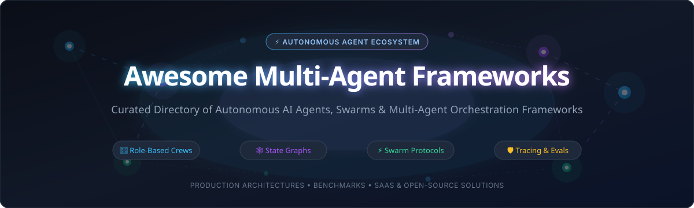
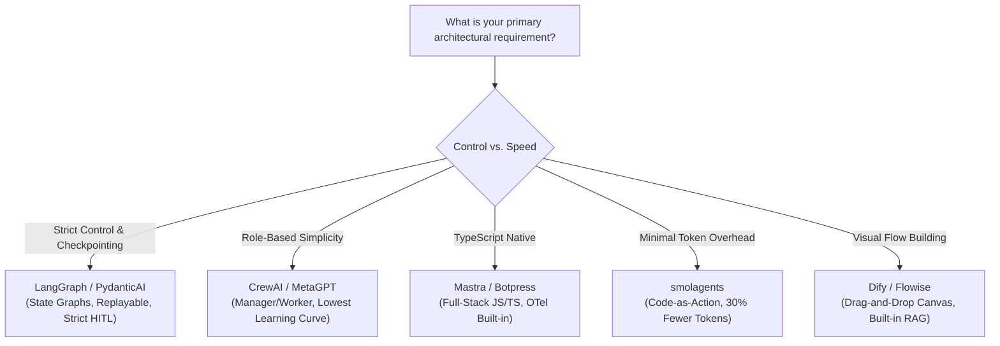

# 🤖 Awesome Multi-Agent Frameworks

### Curated Ecosystem of Autonomous AI Agents, Swarms & Multi-Agent Orchestration Platforms
**A battle-tested guide to role-based crews, graph state machines, swarm intelligence, and production-grade observability.**

  
  
  
  
  
  
  

---

**Keywords**: *Multi-Agent Systems, AI Agents, Agent Orchestration, Autonomous Agents, LLM Frameworks, LangGraph, CrewAI, AutoGen, MetaGPT, Swarm, Graph State Machines, Agentic AI, AI Workforce.*

---

## 📑 Table of Contents

- [🌟 Introduction](#-introduction)
- [📊 Sector Overview & Market Dynamics](#-sector-overview--market-dynamics)
- [☁️ SaaS & Hosted Platforms](#️-saas--hosted-platforms)
- [🐙 Open-Source GitHub Projects](#-open-source-github-projects)
- [📐 Architectural Comparison & Decision Matrix](#-architectural-comparison--decision-matrix)
- [🤝 How to Contribute](#-how-to-contribute)
- [💖 Support & Community](#-support--community)
- [📈 Star History](#-star-history)
- [⚖️ Disclaimer](#️-disclaimer)

---

## 🌟 Introduction

Welcome to **Awesome Multi-Agent Frameworks** — the central repository tracking notable **SaaS platforms** and **open-source frameworks** powering multi-agent systems (MAS). 

Moving beyond naive single-agent prompt loops, modern AI architectures rely on **multi-agent orchestration layers** where specialized agents collaborate, deliberate, delegate, and peer-review each other's outputs. These systems combine explicit state graphs, role-playing crews, hierarchical supervisors, and checkpointed memory to deliver deterministic, auditable, and resilient production workflows.

---

## 📊 Sector Overview & Market Dynamics

The global market for **Multi-Agent Systems (MAS)** and **Autonomous AI Agents** is experiencing exponential expansion, valued between **$7.5 Billion and $15.0 Billion in 2026** and projected to reach **$155 Billion to $375+ Billion by 2035**, compounding at a staggering **CAGR of 43%–48%**.

The sector is currently **highly fragmented**, characterized by intense bottom-up open-source experimentation, low barriers to entry for prompt-to-agent frameworks, and diverse architectural philosophies (state machine graphs vs. conversational loops vs. swarm handoffs). However, enterprise buyers are accelerating a shift toward **platform consolidation** around vendors that provide production-grade governance, deterministic replayability, strict Human-in-the-Loop (HITL) checkpoints, and unified multi-agent observability.

---

## ☁️ SaaS & Hosted Platforms

The table below outlines leading enterprise SaaS platforms and managed developer clouds for autonomous multi-agent workloads. The list is sorted in **descending order by company size (valuation / market capitalization / total capital raised)**.

| 🏢 Platform / Vendor | 💰 Company Size (Valuation / Raised) | 💵 Starting Paid Pricing | 🎁 Free Tier Limit | ⚙️ Multi-Agent Capabilities & Strengths |
| :--- | :--- | :--- | :--- | :--- |
| **[Microsoft Copilot Studio](https://www.microsoft.com/en-us/microsoft-copilot/microsoft-copilot-studio)** | **~$3.1 Trillion** (Market Cap) | **$200 / tenant / month** (Capacity pack with 25,000 pooled messages/month) | **30-day free trial** with 10,000 trial messages & complete agent studio access | Autonomous agent triggers, multi-agent process orchestration, native Microsoft 365, Power Automate, and Azure Foundry ecosystem. |
| **[OpenAI Platform & Agents API](https://platform.openai.com)** | **$157 Billion** (Valuation) | **$0.15 / 1M input tokens** + **$0.60 / 1M output tokens** (GPT-4o mini); **$0.03 / session** (Code Interpreter) | **$5.00 grant credit** upon initial account registration valid for 3 months | Native multi-agent handoffs, parallel tool calling, multi-modal reasoning, hosted vector stores, and structured JSON outputs. |
| **[Cognition AI (Devin)](https://cognition.ai)** | **$2.0 Billion** (Valuation; $196M raised) | **$500 / month** (Devin Core with 250 Agent Compute Units) | **14-day enterprise trial** upon waitlist approval with 25 trial ACUs | Autonomous software engineer multi-agent team capable of full-stack development, sandboxed bash execution, and browser interaction. |
| **[Voiceflow](https://www.voiceflow.com)** | **$105 Million** (Valuation; $38.5M raised) | **$50 / editor / month** (Pro plan billed annually; $60/month billed monthly) | **Free Forever plan** with 2 active agents, 100 KB knowledge base, and 100,000 non-renewing AI credits | Collaborative multi-agent conversational canvas, stateful branching, visual logic flows, and rapid multi-platform deployment. |
| **[CrewAI Enterprise & Cloud](https://www.crewai.com)** | **~$75 Million** (Est. Valuation; $18M Series A) | **$25 / month** (Cloud Starter tier; custom for enterprise) | **Free Forever plan** with 50 cloud crew workflow executions/month and visual editor | Managed orchestration for role-playing crews, visual workflow canvas, enterprise RBAC, audit logs, and one-click cloud deployment. |
| **[Dust](https://dust.tt)** | **$60+ Million** (Series B raised) | **$29 / seat / month** (Pro plan billed monthly; $24/month billed annually) | **Free Forever seat** with 500 lifetime credits for evaluation and workspace testing | Enterprise multi-agent workspace connected to live company knowledge (Slack, Notion, Google Drive, GitHub) with custom permissions. |
| **[Fixie.ai (Ultravox)](https://www.ultravox.ai)** | **$51.5 Million** (Valuation; acquired by Inworld AI) | **$20 / month** (Developer base tier; $0.05/minute for speech runtime overages) | **Free Forever tier** with 30 voice minutes/month and 100 external tool calls/day | Real-time speech-to-speech multi-agent coordination, sub-second latency voice intelligence, and Model Context Protocol (MCP) tool calling. |
| **[Lindy.ai](https://www.lindy.ai)** | **~$50 Million** (Total Venture Raised) | **$29.99 / user / month** (Plus plan billed monthly) | **7-day free trial** with $50 worth of trial execution credits (~3,000 task credits) | Pre-configured autonomous executive agents for email triaging, contract reviews, meeting assistants, and multi-app task execution. |
| **[Relevance AI](https://relevanceai.com)** | **~$42 Million** (Total Venture Raised) | **$19 / month** (Pro plan billed monthly) | **Free Forever plan** with 100 tool action executions/month and 1 active agent | B2B multi-agent workforce orchestration, hierarchical sub-agent delegation, automated research pipelines, and bulk data enrichment. |

---

## 🐙 Open-Source GitHub Projects

The following curated open-source repositories provide self-hosted runtimes, explicit control flows, and transparent agent coordination frameworks. 

The list is sorted in **descending order by GitHub Stars_Count** (updated in real time via live GitHub metrics).

### 1. 🤖 [AutoGPT](https://github.com/Significant-Gravitas/AutoGPT)

- **Description**: The pioneering open-source autonomous agent project striving to make AI agents accessible to everyone. Features a modular multi-agent platform with memory management, web browsing, code execution, and a visual builder.
- **License**: MIT
- **Best For**: Autonomous multi-step goal execution, agent benchmarking, and experimenting with autonomous loops.

### 2. ⚡ [Dify](https://github.com/langgenius/dify)

- **Description**: The open-source LLM application development platform. Features an intuitive visual workflow builder for agentic workflows, multi-agent collaboration, RAG pipelines, model management, and self-hosted VPC deployments.
- **License**: Apache 2.0
- **Best For**: Enterprise teams seeking a visual, collaborative platform with built-in RAG and multi-agent Chatflows.

### 3. 🏢 [MetaGPT](https://github.com/geekan/MetaGPT)

- **Description**: The multi-agent framework that simulates a complete software company. Assigns diverse roles to GPTs (Product Manager, Architect, Project Manager, Engineer, QA) to transform a one-line requirement into PRDs, design documents, and runnable code.
- **License**: MIT
- **Best For**: Complex software development simulations, SOP-driven multi-agent collaboration, and structured artifact generation.

### 4. 🔄 [AutoGen (Microsoft)](https://github.com/microsoft/autogen)

- **Description**: Microsoft's seminal conversational multi-agent framework. Coordinates agents through conversational turns and group chats. *Note*: The repository entered maintenance mode in late 2025 as active development shifted to Microsoft Agent Framework.
- **License**: MIT
- **Best For**: Conversational multi-agent research, existing deployments, and rapid peer-to-peer prototyping.

### 5. 👥 [CrewAI](https://github.com/crewAIInc/crewAI)

- **Description**: The intuitive role-based crew orchestration framework. Engineers define agents with clear roles, goals, and backstories, assembling them into crews that execute tasks sequentially, hierarchically, or collaboratively.
- **License**: MIT
- **Best For**: Content automation pipelines, market research, and workflows with well-defined human-like organizational roles.

### 6. 🎨 [Flowise](https://github.com/FlowiseAI/Flowise)

- **Description**: Drag-and-drop user interface for building customized LLM agent flows, multi-agent networks, and conditional state machines. Provides an Agentflow V2 API for programmatic deployments.
- **License**: Apache 2.0
- **Best For**: Visual-first teams wanting low-code agent canvas design backed by direct API endpoints.

### 7. 🕸️ [LangGraph](https://github.com/langchain-ai/langgraph)

- **Description**: The industry standard for building resilient, controllable multi-agent systems. Models agent workflows as cyclical graphs with explicit state machines, durable checkpointing, time-travel debugging, and Human-in-the-Loop approvals.
- **License**: MIT
- **Best For**: Mission-critical enterprise multi-agent workflows requiring determinism, replayability, and state persistence across process restarts.

### 8. 🚀 [Phidata / Agno](https://github.com/phidatahq/phidata)

- **Description**: High-performance framework for building multimodal, multi-agent systems with built-in memory, knowledge bases, and tool execution. Enables fast, clean agent instantiation with native vector database integrations.
- **License**: MIT
- **Best For**: Developers wanting fast, lightweight Python agent definitions with first-class multimodal and PostgreSQL/PgVector integration.

### 9. 💬 [ChatDev](https://github.com/OpenBMB/ChatDev)

- **Description**: Communicative agent framework simulating an agile software development team. Operates via multi-agent chat chains where agents communicate, review code, and eliminate hallucinations through structured dialogue.
- **License**: Apache 2.0
- **Best For**: Research into communicative multi-agent dynamics and automated end-to-end software synthesis.

### 10. 🛠️ [OpenAI Agents SDK](https://github.com/openai/openai-agents-python)

- **Description**: OpenAI's lightweight, idiomatic Python framework for multi-agent workflows. Features agent primitives, clean handoffs between specialized agents, parallel tool calls, guardrails, and tracing.
- **License**: Apache 2.0
- **Best For**: Teams committed to the OpenAI ecosystem seeking a clean, unopinionated SDK without heavy abstractions.

### 11. 🤗 [smolagents](https://github.com/huggingface/smolagents)

- **Description**: Hugging Face's minimalist agent framework (~1,000 lines of core code) championing **code-as-action**. Agents write Python code blocks rather than cumbersome JSON tool payloads, reducing LLM token consumption by ~30%.
- **License**: Apache 2.0
- **Best For**: Engineers wanting minimal abstractions, direct Hugging Face Hub integration, and code-based tool execution.

### 12. ⚡ [Mastra](https://github.com/mastra-ai/mastra)

- **Description**: The modern TypeScript-native framework for AI applications. Ships with structured workflow graphs, durable state, evals (groundedness, relevance), memory engines, and OpenTelemetry tracing out of the box.
- **License**: Apache 2.0
- **Best For**: Full-stack TypeScript/Node.js teams building production agent workflows without switching to Python.

### 13. 🐝 [Swarm (OpenAI)](https://github.com/openai/swarm)

- **Description**: Educational and exploratory framework demonstrating ergonomic, stateless multi-agent coordination. Introduces clean patterns for agent routines, functions, and client-side handoffs.
- **License**: MIT
- **Best For**: Educational exploration, lightweight agent handoffs, and learning multi-agent coordination fundamentals.

### 14. 🧭 [Google ADK (Agent Development Kit)](https://github.com/google/adk-python)

- **Description**: Google Cloud's code-first multi-agent toolkit. Offers native Vertex AI integration, Sequential, Parallel, and Loop agent primitives, sub-agent hierarchies, and enterprise deployment utilities.
- **License**: Apache 2.0
- **Best For**: Google Cloud / Vertex AI enterprise environments requiring production deployment on Vertex AI Agent Builder.

### 15. 🛡️ [PydanticAI](https://github.com/pydantic/pydantic-ai)

- **Description**: Production-grade agent framework developed by the Pydantic team. Brings strict type safety, dependency injection, streaming responses, and runtime validation to multi-agent architectures.
- **License**: MIT
- **Best For**: Python developers demanding compile-time type verification, robust validation, and native Pydantic integrations.

### 16. 🐫 [CAMEL](https://github.com/camel-ai/camel)

- **Description**: The first communicative multi-agent framework dedicated to studying cooperative agent behavior via "role-playing". Features extensive tool use, social simulations, and scalable multi-agent environments.
- **License**: Apache 2.0
- **Best For**: Multi-agent communicative research, cooperative problem solving, and synthetic agent data generation.

### 17. ⚡ [SuperAGI](https://github.com/TransformerOptimus/SuperAGI)

- **Description**: Developer-first autonomous agent infrastructure. Includes an agent console, telemetry tools, concurrent agent execution, multi-model support, and marketplace connectors.
- **License**: MIT
- **Best For**: Running concurrent autonomous agents with a self-hosted graphical console and tool marketplace.

### 18. 💬 [Botpress](https://github.com/botpress/botpress)

- **Description**: Open-source platform to build and orchestrate autonomous LLM conversational agents. TypeScript-native architecture built for scalable customer support and business process automation.
- **License**: AGPL-3.0 / Commercial
- **Best For**: Enterprise teams building customer-facing multi-agent bots with rich conversational UI integrations.

### 19. 🌐 [Microsoft Agent Framework (MAF)](https://github.com/microsoft/agent-framework)

- **Description**: The enterprise successor to AutoGen and Semantic Kernel. Ships group chat, handoff, and Magentic-One orchestration patterns with Cosmos DB and in-memory checkpointing.
- **License**: MIT
- **Best For**: Enterprise multi-agent deployments built on Azure AI, Microsoft Fabric, and teams migrating away from legacy AutoGen.

### 20. 🔭 [AgentOps](https://github.com/AgentOps-AI/agentops)

- **Description**: The observability and session-replay platform for multi-agent systems. With two lines of code, logs every agent run, tracks tool calls, monitors token costs, and flags failure loops across frameworks.
- **License**: MIT
- **Best For**: Debugging multi-agent communication errors, tracking token usage, and continuous evaluation in CI/CD.

### 21. 🦅 [Agency Swarm](https://github.com/VRSEN/agency-swarm)

- **Description**: Reliable multi-agent orchestration framework built on OpenAI Assistants API. Enforces hierarchical communication structures (CEO, Director, Specialist) to avoid unstructured chatter loops.
- **License**: MIT
- **Best For**: Teams wanting a rigid corporate hierarchy pattern where communication flows strictly through dedicated reporting channels.

### 22. 🦙 [Llama Agents](https://github.com/run-llama/llama-agents)

- **Description**: Async-first, event-driven framework by the LlamaIndex team. Turns agents and multi-agent workflows into microservices that communicate via HTTP/message queues with distributed control planes.
- **License**: MIT
- **Best For**: Distributed microservice architectures where agents run as independent services across distributed infrastructure.

---

## 📐 Architectural Comparison & Decision Matrix

Choosing the right multi-agent framework depends heavily on your team's programming language, need for explicit determinism, and budget constraints.

### 📊 Benchmark & Trade-Off Summary

| Framework | Orchestration Primitive | Token Overhead | Learning Curve | Production Resilience |
| :--- | :--- | :--- | :--- | :--- |
| **LangGraph** | Cyclical State Graph | 🟢 Low (~$12–$18/1k tasks) | 🔴 High (Graph theory) | 🟢 Exceptional (Durable checkpoints) |
| **CrewAI** | Role-Based Hierarchies | 🟡 Moderate (~$18–$28/1k tasks) | 🟢 Low (Fast prototyping) | 🟡 Moderate (Workarounds for loops) |
| **MetaGPT** | SOP & Artifact Chains | 🟡 Moderate | 🟡 Moderate | 🟢 High (Document-driven gates) |
| **AutoGen (Legacy)** | Conversational Turns | 🔴 High (~$25–$40/1k tasks) | 🟢 Low | 🔴 Maintenance Mode |
| **smolagents** | Code-as-Action (Python) | 🟢 Minimal (~30% token reduction) | 🟢 Low | 🟡 Evolving |
| **Mastra** | TypeScript Workflows | 🟢 Low | 🟡 Moderate | 🟢 High (OTel & Evals native) |

---

## 🤝 How to Contribute

Contributions are warmly welcomed! Help us keep this directory exhaustive and up to date:

1. 🍴 **Fork** the repository: [Awesome-Multi-Agent-Frameworks](https://github.com/ishandutta2007/Awesome-Multi-Agent-Frameworks).
2. 🌿 **Create a Branch**: `git checkout -b feature/add-new-framework`.
3. 📝 **Add Your Entry**:
   - Ensure factual accuracy and link to official documentation.
   - Include pricing, free tier details, or GitHub Stars_Count badges.
   - Follow the existing alphabetical or sorted convention.
4. 🚀 **Submit a Pull Request**: Provide a clear explanation of why the framework belongs in this curated collection.

Find more awesome resources in [Awesome-Awesome-Awesome](https://github.com/ishandutta2007/Awesome-Awesome-Awesome)!

---

## 💖 Support & Community

If you found **Awesome Multi-Agent Frameworks** insightful or helpful in architecting your multi-agent applications:

- ⭐ **Star this repository** to help other engineers discover it.
- 🍴 **Fork and share** it with your engineering team and colleagues.
- 💬 **Join our community discussion** on [Discord](https://discord.gg/jc4xtF58Ve).
- ☕ **Sponsor or buy a coffee** to support maintenance and research:
  

    
  

Thank you for being part of the autonomous AI community! 🚀

---

## 📈 Star History

---

## ⚖️ Disclaimer

- This repository is a **community-curated directory** provided for educational and architectural evaluation purposes. Mention of commercial products or open-source projects does not constitute a formal endorsement.
- Multi-agent architectures carry non-trivial operational complexity. Multi-agent designs often incur higher latency, increased token consumption, and cascading hallucination risks compared to single-agent workflows. Always evaluate whether a single well-tooled LLM agent suffices before deploying a multi-agent crew.
- Always implement proper observability (e.g., AgentOps, LangSmith, OpenTelemetry) and Human-in-the-Loop safeguards when deploying autonomous agents with write permissions or financial transaction authority.

---

  Built with ❤️ by AI Engineers for the global Multi-Agent AI community.

